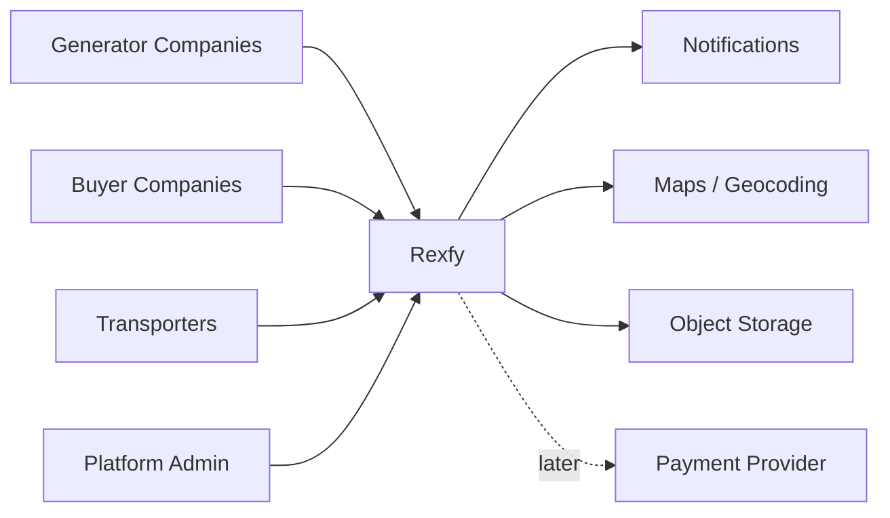
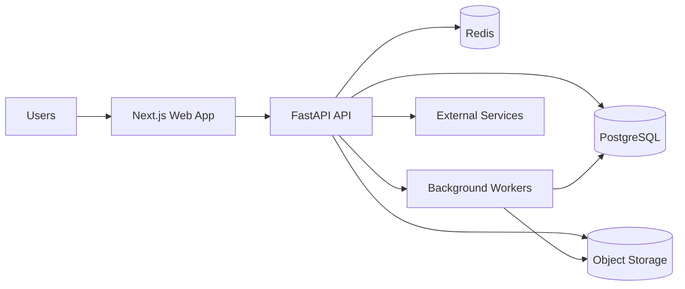
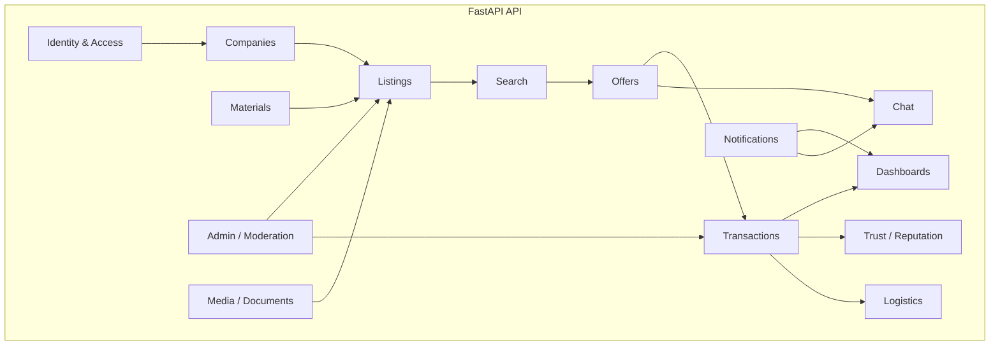

# Rexfy — C4 Architecture Model

## 1) Context

### System
Rexfy is the system that allows industrial companies to buy and sell recyclable materials, coordinate transport, and track trust, disputes, and performance.

### People
- Generator: publishes residue / recyclable material
- Buyer: sources raw secondary material
- Transporter: moves material between companies
- Admin: moderates, verifies, resolves issues

### External systems
- Email / push notifications
- Maps / geocoding
- Object storage for images and documents
- Payment provider (if/when payment rails are introduced)
- Observability stack
- Optional: OCR / file validation later

### C4 Level 1 — context diagram (Mermaid)

## 2) Containers

### Recommended containers
- Web App: Next.js + React + TypeScript
- API: FastAPI + Python
- Database: PostgreSQL
- Cache / queue: Redis
- Background worker: Celery or RQ
- File storage: S3-compatible object storage
- Observability: logs, metrics, traces
- Auth: session/JWT + company-based authorization

### C4 Level 2 — container diagram (Mermaid)

## 3) Components

### Contexts / modules
Recommended bounded contexts for the MVP:
- Identity & Access
- Organizations / Companies
- Materials Catalog
- Marketplace Listings
- Search & Filtering
- Offers / Negotiation
- Chat
- Transactions
- Logistics
- Reputation / Trust
- Notifications
- Dashboard / Analytics
- Admin / Moderation
- Media / Documents

### C4 Level 3 — component map

## 4) Domain model

### Core entities
- User
- Company
- Role
- MaterialCategory
- Material
- Listing
- ListingImage
- Offer
- ChatThread
- Message
- Transaction
- Shipment
- TransportQuote
- Review
- TrustScore
- Dispute
- Document
- Notification
- Subscription
- ESGReport

### Key relationships
- Company has many Users
- Company creates many Listings
- Listing belongs to one Material and one Company
- Listing receives many Offers
- Offer can become one Transaction
- Transaction can create one or more Shipments
- Transaction can generate trust score and review records
- Transaction can attach documents and logistics events

## 5) Event storming starter set

- CompanyRegistered
- UserInvitedToCompany
- ListingCreated
- ListingPublished
- ListingViewed
- OfferReceived
- OfferCountered
- OfferAccepted
- QuoteIssued
- ChatMessageSent
- LogisticsRequested
- TransportQuoteReceived
- ShipmentAssigned
- ShipmentPickedUp
- ShipmentDelivered
- PaymentRecorded
- ReviewSubmitted
- DisputeOpened
- DisputeResolved
- ESGReportGenerated

## 6) Non-functional requirements

### Security
- company-level authorization
- role-based permissions
- audit log for critical actions
- file validation for uploads
- moderation tools for suspicious activity

### Performance
- mobile-first responsiveness
- fast search and filters
- paginated APIs
- cache for repeated lookups
- asynchronous work for heavy tasks

### Reliability
- retryable background jobs
- idempotent transaction endpoints
- graceful degradation if external services fail

### Observability
- structured logs
- request tracing
- metrics for funnel and workflow stages
- alerting on failures and long-running jobs

## 7) Recommended architecture decision

### Recommendation
Start with a modular monolith.

### Why
- simpler team coordination
- faster MVP delivery
- lower operational overhead
- easier domain refactoring
- allows clean boundaries without microservice cost

### Not recommended for the MVP
- microservices
- event sourcing everywhere
- distributed transactions
- multi-region deployment

## 8) Traceability to the product docs

The architecture must directly support:
- user personas
- journey stages
- roadmap phases
- market modules
- trust signals
- logistics flow
- admin operations
- role dashboards
