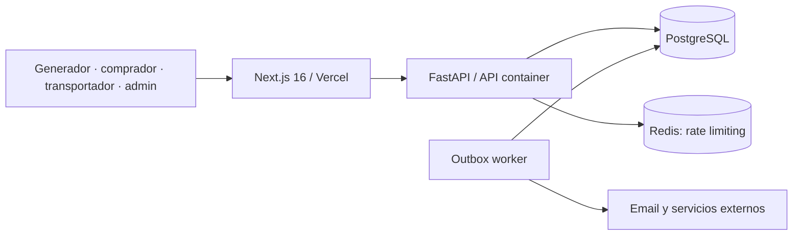

# EP-07 — Arquitectura mantenible

**Estado:** implementada  
**Fecha:** 23 de noviembre de 2026  
**Alcance:** EN-09, US-17, EN-10, EN-11 y EN-13

## Resultado

RexFy permanece como monolito modular: Next.js sirve la experiencia web, FastAPI expone los
casos de uso, PostgreSQL conserva el estado transaccional y un worker independiente procesa el
outbox. No se introdujeron microservicios ni una segunda fuente de verdad. La épica endurece las
fronteras que ya existen para que volumen y cambio funcional no obliguen a reescribirlas.



## Fronteras del backend

| Capa | Responsabilidad | Regla |
|---|---|---|
| `presentation` | HTTP, autenticación, validación y serialización | No decide transiciones ni confirma cambios dentro de servicios |
| `application` | Casos de uso, permisos, idempotencia, auditoría y orquestación | Recibe comandos, puede consultar el ORM y trabaja dentro de un Unit of Work |
| `domain` | Estados y reglas puras | No depende de FastAPI, SQLAlchemy ni Vercel |
| `infrastructure` | ORM, PostgreSQL, Clerk, almacenamiento y correo | Implementa mecanismos; no redefine reglas de negocio |

La unidad de despliegue continúa siendo una sola API. Separar procesos o servicios solo se
considerará cuando exista una carga, un aislamiento operativo o una autonomía de equipo medible;
los nombres de módulos por sí solos no justifican distribución.

El acceso al ORM desde `application` es una decisión consciente del monolito, no una abstracción de
repositorio incompleta. [ADR-007](14_adr_acceso_a_datos.md) registra el alcance y las pruebas de
arquitectura impiden que el dominio dependa de SQLAlchemy o que las capas internas conozcan HTTP.

## Contrato de paginación

Threads, mensajes, órdenes, solicitudes y envíos logísticos, empresas, publicaciones, auditoría y
outbox usan keyset pagination. Cada respuesta de lista tiene esta forma:

```json
{
  "items": [],
  "next_cursor": "cursor-opaco-o-null"
}
```

`limit` acepta de 1 a 100 y vale 25 por defecto. `cursor` es opaco para el cliente y representa el
último par `(created_at, id)` observado; threads usa `(last_activity_at, id)`. El desempate por UUID
impide perder o repetir filas con la misma fecha. Los índices compuestos de la migración
`b7e4a2c91f30` sostienen esas lecturas sin offset creciente. Un cursor malformado devuelve 422.

Los consumidores deben seguir `next_cursor` y no construirlo, persistirlo como identidad ni asumir
que contiene un número de página. Las pantallas de mensajes, órdenes y transporte ofrecen
continuación explícita; la consola limita cada bloque operativo a un máximo conocido.

## Frontera transaccional

Las mutaciones de negociación y logística usan `SqlAlchemyUnitOfWork` como dependencia de
petición. Los servicios agregan y hacen `flush` cuando necesitan IDs o bloqueos; el Unit of Work
realiza un único `commit` después de que el caso de uso termina. Ante una excepción ejecuta
`rollback` y no confirma ningún cambio parcial.

La misma transacción incluye entidad de negocio, idempotencia, auditoría, analítica, notificación y
evento de outbox. Las mutaciones administrativas también usan la frontera de petición. Los commits
explícitos restantes pertenecen al bootstrap de identidad con recuperación de carrera, a la saga de
imágenes con compensación de storage y al worker, cuya unidad de trabajo es una entrega durable.

## Máquinas de estado

Las transiciones permitidas están declaradas en `domain/deals/state_machine.py` y
`domain/logistics/state_machine.py`. Cualquier par no declarado se rechaza.

| Agregado | Transiciones permitidas |
|---|---|
| Oferta | `pending → accepted`, `pending → declined`, `pending → countered` |
| Orden | `agreed → in_transit`, `agreed → completed`, `in_transit → delivered`, `delivered → completed` |
| Envío | `requested → assigned`, `assigned → picked_up`, `picked_up → in_transit`, `picked_up → delivered`, `in_transit → delivered` |

El cierre directo `agreed → completed` conserva el flujo sin transporte gestionado por RexFy. La
entrega directa `picked_up → delivered` conserva viajes cortos donde el estado intermedio no aporta
información. Los tests recorren el producto cartesiano completo de estados válidos e inválidos.

## Comandos y duplicación

Los casos logísticos con firmas extensas reciben `RequestShipment`, `SubmitTransportQuote` y
`AdvanceShipment`. Estos comandos separan el contrato del caso de uso de la forma HTTP y permiten
agregar validaciones sin aumentar parámetros posicionales. Paginación, cursor y Unit of Work son
primitivas compartidas; las políticas propias de cada dominio permanecen en su módulo para evitar
un helper genérico con conocimiento transversal.

## Decisiones y deuda residual

- PostgreSQL sigue siendo la única frontera ACID. No se adopta una transacción distribuida.
- Los cursores no están firmados: son opacos y validados, pero no contienen información sensible.
- Las ofertas dentro de un thread aún son acotadas por la negociación, no tienen endpoint propio.
  Si el producto incorpora revisiones masivas, deberán paginarse con el mismo contrato.
- La consola administrativa consulta hasta 100 empresas o publicaciones por bloque. Antes de
  superar ese volumen operativo debe incorporar filtros o navegación por cursor visible.
- La extracción a servicios independientes queda explícitamente fuera de alcance mientras no haya
  evidencia de escalado o ownership que compense la complejidad distribuida.

## Evidencia de aceptación

- OpenAPI y tipos TypeScript regenerados con el nuevo contrato.
- Tests exhaustivos de oferta, orden y envío.
- Test de round-trip y rechazo de cursores inválidos.
- Test de integración que recorre mensajes sin duplicados mediante `next_cursor`.
- Test de commit único y rollback del Unit of Work.
- Ruff, ESLint, TypeScript, Vitest y build de Next.js forman la puerta de calidad de la épica.
